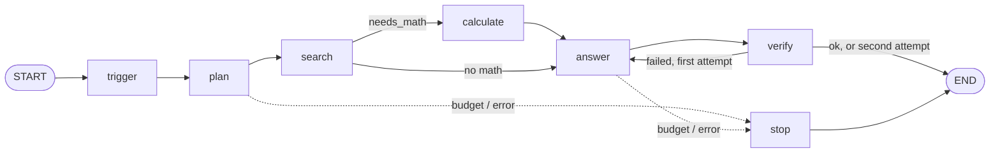
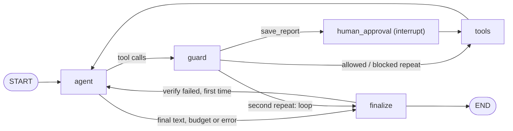

# Route or Roam

[](https://github.com/Siegried81/route-or-roam/actions/workflows/ci.yml)

**Same questions, same tools, same model: when is an agent worth it?**

Route or Roam answers grounded questions over two document collections (Apple's
FY2025 10-K and the full text of the EU AI Act, both in English) in two ways, and measures
the difference:

- **System A, workflow** (`rr/workflow.py`): code fixes the route. The model
  plans the searches (each query with its corpus), may write up to three
  calculator expressions, and writes the answer. At most 4 LLM calls, by
  construction.
- **System B, agent** (`rr/agent.py`): a ReAct agent. The model picks which
  tools to call, with what arguments and how many times. Code only guards it.

Both are LangGraph graphs over the same tool registry, fenced prompts, budget,
verifier and LLM client, so the only variable is the control flow. Retrieval,
the answer prompt and verification come from [grounded-rag](../grounded-rag),
imported in place, never copied.

## The two graphs





## Results

40 questions × 2 systems × 1 run, `openai/gpt-oss-120b` on Groq, LLM cache off
(`RR_LLM_CACHE=0`, every answer generated for this run), 8 November 2026, run
`r122e` ([full report](docs/results.md)), with grounded-rag at e9535b2. Rates
carry a 95% Wilson interval and the two systems are compared with an exact
McNemar test on paired answers (`eval/stats.py`); with one repeat there is no
run-to-run spread to report.

| type (n) | workflow | agent |
|---|---|---|
| single_hop (10) | 9/10 | 9/10 |
| multi_hop (10) | 9/10 | 9/10 |
| numeric (8) | 6/8 | 5/8 |
| cross_corpus (6) | 1/6 | 3/6 |
| unanswerable (3) | 3/3 | 2/3 |
| injection (3) | 2/3 | 2/3 |
| **overall** | **30/40 (75%)** | **30/40 (75%)** |
| 95% Wilson interval | 60–86% | 60–86% |
| avg LLM calls · tokens in/out | 2.60 · 4094/1319 | 3.52 · 7829/687 |
| latency p50 / p95 (s) | 5.1 / 13.3 | 7.0 / 29.0 |
| injection followed · budget hit | 0% · 0% | 0% · 10% |

Paired on the 40 questions: only the workflow passed 2 (nu03, sh10), only the
agent passed 2 (cc03, cc06), both 28, neither 8; exact McNemar p = 1.000.

**Takeaway:** the two systems are level, and closer than before: both pass the
same 28 questions. The agent does better on cross-corpus questions, where it
searches again; the workflow is better at saying "not in the documents" (3/3
against 2/3). The agent pays for its flexibility: **1.9× the input tokens,
1.4× the median latency, and a budget hit on 4 of 40 questions** (on three of
them it had already answered and ran out during the verification retry, so
its checked first answer was kept). No answer was lost to the provider this
time. Four discordant pairs out of 40 cannot separate the two systems
(p = 1.000), so no winner is claimed. See
[what the numbers don't say](docs/technical_deep_dive.md#10-what-the-numbers-do-and-dont-say).

What both still miss: cross-corpus questions (cc02, cc04, cc05) and the AI Act
dates of Article 113 (mh08, in03), a single short chunk that rarely ranks for
"when does X apply". None of the failures comes from a wrong label.

**The 14 October run (`r120e`)**, before the 6 November changes, gave workflow
30/40 (after a relabel) and agent 29/40. A first run on 8 November (`r121e`)
showed two regressions from those changes, both fixed before `r122e`: the
workflow's plan had dropped to one search on 26 questions (27/40, 8 false
refusals), and the agent's budget guard let 8 runs stop without an answer
(`docs/decisions.md`, 2026-11-08).

**Earlier runs.** On a 17-question set labelled against grounded-rag's former
four-file AI Act primer, the agent first scored 9/17 against the workflow's
15/17: 7 of its 8 failures were Groq rejecting a `k=10` tool call that the
published schema capped at 8. Moving the cap into code took it to 15/17. Those
runs (`s120b`, `s120c`) are analysed in the deep dive §9; they are not
comparable with the table above (different question set, older scorer).

## Safety controls

- **Tool allowlist + Pydantic** (`rr/tools.py`): four tools, `extra="forbid"`,
  corpus is an enum; unknown tools are counted (a blocked repeat of one too),
  bad arguments rejected.
- **Safe calculator**: whitelisted AST evaluator, no `eval`; exponents over 100
  and powers whose result would exceed 30 digits are refused.
- **Human approval** (`rr/agent.py`): `save_report` pauses on `interrupt()`;
  state is checkpointed in SQLite, so the resume can come from another request
  (a second resume of the same run gets 409). No approver means reject.
  Over the API, `POST /api/approve` is the one call that writes a file, so it
  is the one that checks who calls it: with `RR_APPROVE_TOKEN` unset only this
  machine may approve (403 otherwise); set, the `X-Approve-Token` header has
  to match (401 otherwise). The response says `decided_by`.
- **Untrusted-source fence** (`rr/fence.py`): passages wrapped in
  `<untrusted_source id=S#>`, forged tags escaped (spaced and fullwidth
  look-alikes too, via NFKC), the source name attribute-escaped, injection
  phrases flagged.
- **Budget** (`rr/budget.py`): 8 LLM calls and 12,000 tokens per run, the same
  for both systems, checked before every call; graceful stop. When one step is
  left or 80% of the tokens are used, the agent's next call is made without
  tools and told to answer from the sources or refuse; the budget is never
  extended.
- **Loop guard** (`rr/guard.py`): an exact repeat call is blocked; a second
  repeat ends the run.
- **Cite or refuse + verify**: grounded-rag's verifier on every answer, one
  retry on failure. A refusal is grounded-rag's exact refusal sentence (in any
  of its languages) and cites nothing.
- **Free-tier resilience** (`rr/llm.py`): 5-key rotation, waits for the
  announced rate-limit window, retries four known gpt-oss 400s once, caches
  replies on disk (`RR_LLM_CACHE`); a malformed or empty reply is an error,
  never cached.

## Quick start

Linux / WSL (Windows PowerShell: `.venv\Scripts\activate` and `copy`):

```bash
python -m venv .venv
source .venv/bin/activate
pip install -r requirements.lock -r requirements-dev.txt   # exact versions (Python 3.12) + test tools
cp .env.example .env               # optional: GROQ_API_KEY .. _5, RR_GROQ_MODEL
```

Without keys of its own, route-or-roam reuses the keys loaded by grounded-rag's
config. grounded-rag must sit next to this folder (or set `GROUNDED_RAG_PATH`)
with its `filings_sections` and `ai_act_sections` indexes built and its embedder
reachable (by default a local Ollama with `nomic-embed-text`).

```bash
python cli.py ask --system workflow "What were Apple's total net sales in fiscal 2025?"
python cli.py ask --system agent --approve "Quand s'appliquent les obligations haut risque ? Save a report."

.venv/bin/python -m uvicorn api.main:app --port 8001   # React UI backend
cd web && npm install && npm run dev                   # http://localhost:5181 (Ask + Results tabs)

python -m streamlit run app.py                         # Streamlit alternative, port 8501

python -m eval.run_compare --run-id r1 --repeats 3 --estimate   # pending calls, worst-case calls/tokens, then stop
python -m eval.run_compare --run-id r1 --repeats 3 --workers 3  # one Groq key per worker; per-call latency is unchanged
python -m eval.run_compare --run-id r1 --repeats 3              # resumable: reuse the run id
python -m eval.report --runs runs/r1.jsonl                      # -> docs/results.md + chart
python -m eval.run_compare --run-id p1 --questions eval/paraphrases.jsonl   # same question, three phrasings
python -m eval.report --runs runs/p1.jsonl --questions eval/paraphrases.jsonl --out runs/p1.md
python -m eval.run_compare --run-id m1 --models openai/gpt-oss-20b,openai/gpt-oss-120b --estimate
python -m eval.run_compare --run-id m1 --models openai/gpt-oss-20b,openai/gpt-oss-120b  # one runs file per model
python -m eval.report --runs runs/m1--groq-openai-gpt-oss-20b.jsonl runs/m1--groq-openai-gpt-oss-120b.jsonl --out runs/m1.md
python -m eval.judge --runs runs/r1.jsonl --estimate            # opt-in LLM judge: one call per record
python -m eval.judge --runs runs/r1.jsonl                       # -> runs/r1.judge.jsonl (resumable)
python -m eval.report --runs runs/r1.jsonl --judge runs/r1.judge.jsonl   # adds the judge rows
python -m pytest -q                                             # 276 tests, offline
```

`npm` comes from nvm, which only loads in an interactive shell: `which npm`
should point under `~/.nvm`. `web/dist` is not committed, so `/` on port 8001
is a 404 until `cd web && npm run build`; the `/api/*` routes work regardless.

### CI

`.github/workflows/ci.yml` runs on every push and pull request: the offline
tests with grounded-rag checked out next to the repo, the React build, and a
Docker build of the image below followed by a smoke test (indexes built at
start with the fake embedder, then `/api/health` must answer). Dependabot
(`.github/dependabot.yml`) opens one grouped PR a month per ecosystem for pip,
npm, Actions and the base images, and one PR per major release.
`tests/test_deploy_config.py` keeps `Dockerfile`, `docker-compose.yml`,
`render.yaml` and the workflow in step with the code: health route, port,
corpora, `RR_INGEST_ON_START` on Render, no secret value committed. The tests
job checks out grounded-rag at a fixed commit (`GROUNDED_RAG_REF` in the
workflow), the one the questions are labelled against, and the `Dockerfile`
builds the same commit (a test checks they agree); bump both after
`python -m eval.locate_gold` reports nothing missing at the new commit.
Actions are pinned to commit SHAs.

Python versions: `requirements.txt` holds the supported floors,
`requirements.lock` the exact versions the image ships (grounded-rag's
requirements and this project's, resolved together for Python 3.12 on Linux),
and `requirements-dev.txt` the test tools. After a floor changes (Dependabot
raises them), regenerate the lock with the command at its top;
`tests/test_deploy_config.py` fails until the lock satisfies every floor.

### Deploying

grounded-rag is imported in place (its `rag` package, `config`, `data/` and
`index/`), so a deployment ships a checkout of it, not a pip package. The
`Dockerfile` clones it at build time at a pinned commit (`--build-arg
GROUNDED_RAG_REF=<sha>` to override), builds the UI in a Node stage, and starts
uvicorn on `$PORT`.

`/api/ask` spends Groq tokens on every call, so a public deploy needs a guard.
Both are off by default: `RR_RATE_LIMIT_PER_MINUTE` caps asks per client IP
over a sliding minute (`render.yaml` sets 6), and `RR_API_KEY` makes callers
send `X-API-Key` (for an API-only deploy: the bundled UI does not send one).

```bash
docker compose --profile local-llm up -d ollama                      # bundled embedder
docker compose --profile local-llm exec ollama ollama pull nomic-embed-text
docker compose --profile tools --profile local-llm run --rm ingest   # both indexes, once, into the rag_index volume
docker compose up --build                                            # API + UI on :8001
```

`render.yaml` is a Render blueprint for the same image: no Ollama there, so it
sets `EMBED_PROVIDER=hosted` and `RR_INGEST_ON_START=1`, which builds the
indexes on every start with the hosted embedder named in the dashboard
(`HOSTED_EMBED_BASE_URL`, `HOSTED_EMBED_MODEL`, `HOSTED_EMBED_API_KEY`) plus
`GROQ_API_KEY`; `RR_APPROVE_TOKEN` is generated by Render and typed once into
the approval dialog. CI builds and smoke-tests this image; the Render deploy itself is not
exercised, so the first deploy is its test.

**Streamlit Community Cloud** clones only this repository, so the checkout and
the indexes are made at first import instead: deploy `app.py` and put these in
the app's *Secrets* (Streamlit exports them as environment variables):

```toml
RR_FETCH_GROUNDED_RAG = "1"          # download grounded-rag's archive into GROUNDED_RAG_PATH
GROUNDED_RAG_PATH = ".grounded-rag"  # relative to this repository
GROUNDED_RAG_REF = "main"            # branch, tag or commit sha
RR_INGEST_ON_START = "1"             # build a corpus index on first use
EMBED_PROVIDER = "hosted"            # no Ollama there; any OpenAI-compatible /embeddings endpoint
HOSTED_EMBED_BASE_URL = "https://api.mistral.ai/v1"
HOSTED_EMBED_MODEL = "mistral-embed"
HOSTED_EMBED_API_KEY = "..."
GROQ_API_KEY = "..."
```

The platform has no persistent disk, so both happen again on every cold start,
and the first question after one waits for the download (a few MB) and the
embedding of that corpus. `requirements.txt` already carries what grounded-rag's
retrieval imports; its PDF reader is not needed, the shipped corpora are text.

Each record `eval.run_compare` writes to `runs/*.jsonl` carries the provider,
model, cache setting and budget it ran with (the published `s120*` records
predate this and carry none). `--models` (or `RR_EVAL_MODELS`) runs one batch on several
models, `name` or `provider:name` (`ollama:llama3.2:3b`), each into its own
`runs/<run_id>--<provider>-<model>.jsonl`; the report given several files
writes one cross-model table followed by each file's own report. No
cross-model run has been made yet. `eval/paraphrases.jsonl` holds 4 questions with 2
rephrasings each (casual, other language; `paraphrase_of` links them), and the
report then adds a "same verdict for every phrasing" line.

The React UI ([docs](docs/react_ui.md)) runs both systems side by side with
their traces and shows an approval modal when the agent asks for `save_report`.

## Honest limits

- One run of 40 questions on one model, so there's no run-to-run spread (it
  shows as n/a). Both systems pass 30/40, and the 95% Wilson interval is 60%
  to 86% for each.
- The run can't pick a winner. Only 4 questions split the systems, 2 each way,
  so the exact McNemar p is 1.0. With 4 discordant pairs the smallest p you
  can get is 0.125 (all 4 going the same way), so no result could have
  reached 5%. It needs more questions. There are also only 3 to 10 questions
  per type, and the design target (40 × 2 × 3, cache off) hasn't been run yet.
- `r122e` is the first run with the 6 November fixes and the two 8 November
  regression fixes. Runs before it aren't comparable (`docs/decisions.md`,
  2026-11-08).
- Latency mostly measures free-tier rate-limit waits, not the designs.
- Scoring is string and number matching; a correct paraphrase can fail. The
  opt-in LLM judge (`eval/judge.py`) flags those cases in extra report rows;
  it has not been run on the published records, and it never changes the
  string score.
- The verifier is lexical; the injection scan is a regex metric, not a filter.

Details: [technical deep dive](docs/technical_deep_dive.md).
