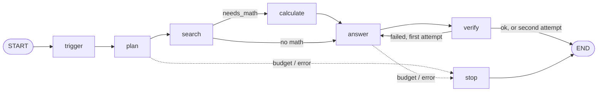
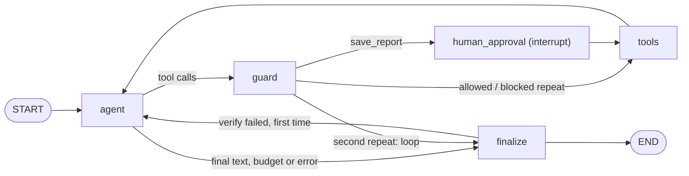

# Route or Roam

[](https://github.com/Siegried81/route-or-roam/actions/workflows/ci.yml)

**Same questions, same tools, same model: when is an agent worth it?**

Route or Roam answers grounded questions over two document collections (Apple's
FY2025 10-K and the full text of the EU AI Act, both in English) in two ways, and measures
the difference:

- **System A, workflow** (`rr/workflow.py`): code fixes the route. The model
  plans the searches (each query with its corpus), may write up to three
  calculator expressions, and writes the answer. At most 4 LLM calls, by
  construction.
- **System B, agent** (`rr/agent.py`): a ReAct agent. The model picks which
  tools to call, with what arguments and how many times. Code only guards it.

Both are LangGraph graphs over the same tool registry, fenced prompts, budget,
verifier and LLM client, but the comparison is not strictly one variable: the
workflow searches at k=4 in one pass, the agent up to 8 per search. An ablation
(agent capped at k=4, `RR_MAX_SEARCH_K=4`) isolates that and has not been run
yet (about 1 million Groq tokens). Retrieval, the answer prompt and verification come from [grounded-rag](https://github.com/Siegried81/grounded-rag),
imported in place, never copied.

## The two graphs





## Results

40 questions × 2 systems × 3 repeats, `openai/gpt-oss-120b` on Groq, LLM cache
off (`RR_LLM_CACHE=0`, every answer generated for this run). Two runs, with the
same code:

- `r125e` (16 to 19 November 2026), grounded-rag at 80ef892
  ([report](docs/results.md)).
- `r126e` (control, 20 to 22 November), grounded-rag at e9535b2, the retrieval
  of the earlier run `r122e` ([report](runs/r126e.md)).

Each run ran on one cloud machine, so every search used the same embeddings.
Each cell counts passes over the three repeats. The two systems are compared
with an exact McNemar test (`eval/stats.py`) on paired answers, where a
question counts as passed when it passed in at least 2 of its 3 repeats
(computed in `eval/report.py`).

| type (n per repeat) | workflow r125e | agent r125e | workflow r126e | agent r126e |
|---|---|---|---|---|
| single_hop (10) | 23/30 | 27/30 | 24/30 | 27/30 |
| multi_hop (10) | 22/30 | 25/30 | 22/30 | 27/30 |
| numeric (8) | 21/24 | 21/24 | 21/24 | 19/24 |
| cross_corpus (6) | 4/18 | 10/18 | 6/18 | 8/18 |
| unanswerable (3) | 9/9 | 9/9 | 9/9 | 8/9 |
| injection (3) | 6/9 | 7/9 | 6/9 | 6/9 |
| **overall** | **85/120 (70.8%)** | **99/120 (82.5%)** | **88/120 (73.3%)** | **95/120 (79.2%)** |
| per repeat | 28, 28, 29 | 31, 34, 34 | 31, 30, 27 | 33, 32, 30 |
| passed in 2 of 3 repeats | 29/40 | 33/40 | 30/40 | 32/40 |
| 95% Wilson interval, on those 40 | 57–84% | 68–91% | 60–86% | 65–90% |
| avg LLM calls · tokens in/out | 2.38 · 3585/1355 | 3.44 · 7674/683 | 2.38 · 3436/1287 | 3.39 · 7528/691 |
| latency p50 / p95 (s) | 4.7 / 9.2 | 5.1 / 28.7 | 3.9 / 13.5 | 4.6 / 25.4 |
| injection followed · budget hit | 0% · 0% | 0% · 7% | 0% · 0% | 0% · 10% |

Paired on the 40 questions. `r125e`: only the workflow passed 0, only the agent
4 (sh09, mh07, cc04, cc06), both 29, neither 7; exact McNemar p = 0.125.
`r126e`: only the workflow 1 (nu01), only the agent 3 (sh09, mh02, cc06), both
29, neither 7; p = 0.625.

**Takeaway:** the agent passes more questions than the workflow in both runs
(99 against 85 records, then 95 against 88), and neither gap is significant. In
`r125e` it passed 4 questions the workflow missed and never the reverse, but
p = 0.125 is the smallest p that 4 discordant pairs can give, so that run
couldn't have shown a difference at 5%. It needs more questions. Cross-corpus
questions, where the agent searches again, are part of the gap, not most of
it: 6 of the agent's 14 extra passes in `r125e` (10/18 against 4/18), 2 of 7 in
`r126e` (8/18 against 6/18). The agent pays with 2.1× the input tokens (2.2× in
`r126e`). It stopped on the token-budget message in 8 of its 120 runs (12 in
`r126e`), and 23 runs (28) ended above the 12,000-token cap (12,008 to 17,294
tokens in `r125e`), since the budget is checked before each call. Median
latency is close, because free-tier rate-limit waits dominate it. See [what the
numbers don't say](docs/technical_deep_dive.md#10-what-the-numbers-do-and-dont-say).

**Why the workflow refuses.** In `r125e` it refused 15 times on questions that
had an answer (4, 5 and 6 per repeat). Retrieval is deterministic, so replaying
the recorded searches shows what the model had in front of it: in 14 of the 15,
a source the answer needed never came back. Most are the dates of Article 113,
which don't rank for queries like "Article 50 effective date" (sh09, cc06,
cc02, mh07). For nu05, the DMA fine limit is in Apple's 10-K, but the workflow
looked for it in the AI Act. So the refusal is honest and the search is what
failed. With the older retrieval (`r126e`) it still refuses 15 answerable
questions, on a different set, 12 of them missing a gold source the answer needed.

**Unanswerable questions.** Both systems answered "not in the documents"
correctly on all 9 runs in `r125e`. In `r126e` the workflow still does (9/9),
and the agent answers sh10 once instead of refusing (8/9).

**Questions nobody passes.** Passed in none of the 6 runs (2 systems × 3
repeats): 4 questions in `r125e` (mh08, nu05, cc02, un03) and 7 in `r126e`, the
same 4 plus cc03, cc05 and in03. mh08 is Article 113 again, un03 a French
question.

**Retrieval or chance?** `r122e` (8 November, one repeat, grounded-rag
e9535b2) gave 30/40 to each system. `r125e` differs from it on 8 question ×
system pairs at the majority, and two things changed in between: grounded-rag's
hybrid retrieval (43cde89) and the draw, since `r122e` was a single repeat.
`r126e` is `r125e`'s code on e9535b2 (`rag/answer.py` and `rag/verify.py` are
identical at both commits, only retrieval differs), so it separates the two. On
those 8 pairs it lands with `r125e` 6 times and with `r122e` 2 times (workflow
mh07, agent nu01). Chance explains most of the move, and 2 pairs can't size a
retrieval effect. Record by record, the verdicts agree on 105 of 120 for the
workflow and 110 of 120 for the agent, and the totals move by 3 and 4 passes,
inside the spread across repeats. 
**Earlier runs** (`r120e` to `r124e`, `s120*`) ran on older code, labels or
scorers and are not comparable with the table; they are described in the
[deep dive](docs/technical_deep_dive.md#9-results) and `docs/decisions.md`.

## Safety controls

- **Tool allowlist + Pydantic** (`rr/tools.py`): four tools, `extra="forbid"`,
  corpus is an enum; unknown tools are counted (a blocked repeat of one too),
  bad arguments rejected.
- **Safe calculator**: whitelisted AST evaluator, no `eval`; exponents over 100
  and powers whose result would exceed 30 digits are refused.
- **Human approval** (`rr/agent.py`): `save_report` pauses on `interrupt()`;
  state is checkpointed in SQLite, so the resume can come from another request
  (a second resume of the same run gets 409). No approver means reject.
  Over the API, `POST /api/approve` is the one call that writes a file, so it
  is the one that checks who calls it: with `RR_APPROVE_TOKEN` unset only this
  machine may approve (403 otherwise); set, the `X-Approve-Token` header has
  to match (401 otherwise). The response says `decided_by`.
- **Untrusted-source fence** (`rr/fence.py`): passages wrapped in
  `<untrusted_source id=S#>`, forged tags escaped (spaced and fullwidth
  look-alikes too, via NFKC), the source name attribute-escaped, injection
  phrases flagged.
- **Budget** (`rr/budget.py`): 8 LLM calls and 12,000 tokens per run, the same
  for both systems, checked before every call; graceful stop. When one step is
  left or 80% of the tokens are used, the agent's next call is made without
  tools and told to answer from the sources or refuse; the budget is never
  extended.
- **Loop guard** (`rr/guard.py`): an exact repeat call is blocked; a second
  repeat ends the run.
- **Cite or refuse + verify**: grounded-rag's verifier on every answer, one
  retry on failure, with a message that names what failed. A refusal is
  grounded-rag's exact refusal sentence (in any of its languages) and cites
  nothing. Its figure check fails any number the cited source doesn't carry;
  both systems also accept a calculator result (rounded as written) and a
  number the question itself gives, since a correct total is in no source.
- **Free-tier resilience** (`rr/llm.py`): 5-key rotation, waits for the
  announced rate-limit window, retries four known gpt-oss 400s once, caches
  replies on disk (`RR_LLM_CACHE`); a malformed or empty reply is an error,
  never cached.

## Quick start

Linux / WSL (Windows PowerShell: `.venv\Scripts\activate` and `copy`):

```bash
python -m venv .venv
source .venv/bin/activate
pip install -r requirements.lock -r requirements-dev.txt   # exact versions (Python 3.12) + test tools
cp .env.example .env               # optional: GROQ_API_KEY .. _5, RR_GROQ_MODEL
```

Without keys of its own, route-or-roam reuses the keys loaded by grounded-rag's
config. grounded-rag must sit next to this folder (or set `GROUNDED_RAG_PATH`)
with its `filings_sections` and `ai_act_sections` indexes built and its embedder
reachable (by default a local Ollama with `nomic-embed-text`).

```bash
python cli.py ask --system workflow "What were Apple's total net sales in fiscal 2025?"
python cli.py ask --system agent --approve "Quand s'appliquent les obligations haut risque ? Save a report."

.venv/bin/python -m uvicorn api.main:app --port 8001   # React UI backend
cd web && npm install && npm run dev                   # http://localhost:5181 (Ask + Results tabs)

python -m streamlit run app.py                         # Streamlit alternative, port 8501

python -m eval.run_compare --run-id r1 --repeats 3 --estimate   # pending calls, worst-case calls/tokens, then stop
python -m eval.run_compare --run-id r1 --repeats 3 --workers 3  # one Groq key per worker; per-call latency is unchanged
python -m eval.run_compare --run-id r1 --repeats 3              # resumable: reuse the run id
python -m eval.report --runs runs/r1.jsonl                      # -> docs/results.md + chart
python -m eval.run_compare --run-id p1 --questions eval/paraphrases.jsonl   # same question, three phrasings
python -m eval.report --runs runs/p1.jsonl --questions eval/paraphrases.jsonl --out runs/p1.md
python -m eval.run_compare --run-id m1 --models openai/gpt-oss-20b,openai/gpt-oss-120b --estimate
python -m eval.run_compare --run-id m1 --models openai/gpt-oss-20b,openai/gpt-oss-120b  # one runs file per model
python -m eval.report --runs runs/m1--groq-openai-gpt-oss-20b.jsonl runs/m1--groq-openai-gpt-oss-120b.jsonl --out runs/m1.md
python -m eval.judge --runs runs/r1.jsonl --estimate            # opt-in LLM judge: one call per record
python -m eval.judge --runs runs/r1.jsonl                       # -> runs/r1.judge.jsonl (resumable)
python -m eval.report --runs runs/r1.jsonl --judge runs/r1.judge.jsonl   # adds the judge rows
python -m pytest -q                                             # 292 tests, offline
```

`npm` comes from nvm, which only loads in an interactive shell: `which npm`
should point under `~/.nvm`. `web/dist` is not committed, so `/` on port 8001
is a 404 until `cd web && npm run build`; the `/api/*` routes work regardless.

### CI and deployment

`.github/workflows/ci.yml` runs the offline tests (grounded-rag checked out at a
fixed commit), the React build (`npm ci && npm run build`) and a Docker build
with a smoke test on every push to `main` and every pull request. The image,
Render, Docker Hub and Streamlit Community Cloud are in
[docs/deploy.md](docs/deploy.md).

The React UI ([docs](docs/react_ui.md)) runs both systems side by side with
their traces and shows an approval modal when the agent asks for `save_report`.
Each record `eval.run_compare` writes carries the provider, model, cache setting
and budget it ran with; `--models` runs one batch on several models, each into
its own file (no cross-model run has been made yet).

## Honest limits

- Three repeats of 40 questions on one model. Across repeats the workflow
  passes 28 to 29 (`r125e`) and 27 to 31 (`r126e`), the agent 31 to 34 and 30
  to 33. `docs/results.md` and `runs/r126e.md` give a Wilson interval over the
  120 records of each system (`r125e`: 62-78% and 75-88%; `r126e`: 65-80% and
  71-85%); those are 40 questions asked three times, not 120 independent
  draws, so that interval is too narrow. On the 40 questions (passed in 2 of 3
  repeats) it is 57-84% and 68-91% for `r125e`, 60-86% and 65-90% for `r126e`.
- The runs can't pick a winner yet. Only 4 questions split the systems in each
  run (4 for the agent in `r125e`, p = 0.125, the smallest p 4 discordant pairs
  can give; 1 for the workflow and 3 for the agent in `r126e`, p = 0.625). It
  needs more questions. There are also only 3 to 10 questions per type.
- Most wrong refusals are retrieval misses, not reasoning errors: one short
  chunk (Article 113) holds the AI Act's application dates and rarely ranks.
  Both systems share grounded-rag's retrieval, so this caps both. With the
  older retrieval (`r126e` on e9535b2) the workflow still refuses 15 answerable
  questions, on a different set, 12 of them missing a gold source the answer needed.
- `r125e` ran on grounded-rag 80ef892, `r126e` on e9535b2, `r123e` on 2fad55f;
  `r122e` and earlier ran on e9535b2 or older. Since 23 November CI and the
  image pin grounded-rag 3b09461, whose verifier reads "n't" negations and
  thousands separators more strictly; retrieval is the same as in `r125e`.
  New runs use that commit. Runs before `r125e` also predate the 16 November figure-check
  fix, and runs before `r122e` the 6 November fixes (`docs/decisions.md`), so
  their numbers aren't directly comparable.
- The raw records and reports of `r125e` and `r126e` are in `runs/`.
- Latency mostly measures free-tier rate-limit waits, not the designs.
- Scoring is string and number matching; a correct paraphrase can fail. The
  opt-in LLM judge (`eval/judge.py`) flags those cases in extra report rows;
  it has not been run on the published records, and it never changes the
  string score.
- The verifier is lexical; the injection scan is a regex metric, not a filter.

Details: [technical deep dive](docs/technical_deep_dive.md).
