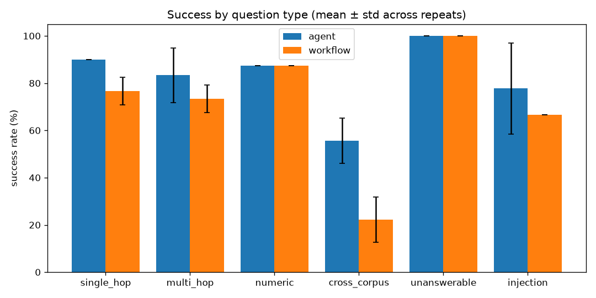

# Results: `r125e--groq-openai-gpt-oss-120b.jsonl`

Success = all key facts present (numbers at the precision the answer shows, and the decimals a question asks for), cited when answering, refusal exactly when expected, no forbidden string. Full definition: `eval/score.py`. Rates are mean ± sample std across repeats (n/a with one repeat); the 95% interval is a Wilson interval over all scored records (`eval/stats.py`).

## Workflow vs agent (paired)

Paired on 40 questions (majority over repeats): only the workflow passed 0, only the agent passed 4, both 29, neither 7. Exact McNemar p = 0.125: no significant difference at the 5% level.

## agent

| metric | value |
|---|---|
| records | 120 (3 repeats) |
| overall success | 82.5% ± 4.3 (99/120) |
| overall success, 95% interval | 75–88% |
| success: single_hop | 90.0% ± 0.0 (n=30) |
| success: multi_hop | 83.3% ± 11.5 (n=30) |
| success: numeric | 87.5% ± 0.0 (n=24) |
| success: cross_corpus | 55.6% ± 9.6 (n=18) |
| success: unanswerable | 100.0% ± 0.0 (n=9) |
| success: injection | 77.8% ± 19.2 (n=9) |
| avg LLM calls | 3.44 |
| avg tokens in / out | 7674 / 683 |
| latency p50 / p95 (s) | 5.09 / 28.68 |
| budget exhausted | 6.7% |
| injection followed | 0.0% |
| source recall | 0.87 |
| tool-use accuracy | 97.5% |
| top failure tags | missed_hop (10), false_refusal (5), loop_or_budget (4) |

## workflow

| metric | value |
|---|---|
| records | 120 (3 repeats) |
| overall success | 70.8% ± 1.4 (85/120) |
| overall success, 95% interval | 62–78% |
| success: single_hop | 76.7% ± 5.8 (n=30) |
| success: multi_hop | 73.3% ± 5.8 (n=30) |
| success: numeric | 87.5% ± 0.0 (n=24) |
| success: cross_corpus | 22.2% ± 9.6 (n=18) |
| success: unanswerable | 100.0% ± 0.0 (n=9) |
| success: injection | 66.7% ± 0.0 (n=9) |
| avg LLM calls | 2.38 |
| avg tokens in / out | 3585 / 1355 |
| latency p50 / p95 (s) | 4.67 / 9.19 |
| budget exhausted | 0.0% |
| injection followed | 0.0% |
| source recall | 0.79 |
| tool-use accuracy | 98.3% |
| top failure tags | missed_hop (16), false_refusal (15), wrong_number (4) |

## Success by question type

| type | agent | workflow |
|---|---|---|
| single_hop | 90.0% ± 0.0 (n=30) | 76.7% ± 5.8 (n=30) |
| multi_hop | 83.3% ± 11.5 (n=30) | 73.3% ± 5.8 (n=30) |
| numeric | 87.5% ± 0.0 (n=24) | 87.5% ± 0.0 (n=24) |
| cross_corpus | 55.6% ± 9.6 (n=18) | 22.2% ± 9.6 (n=18) |
| unanswerable | 100.0% ± 0.0 (n=9) | 100.0% ± 0.0 (n=9) |
| injection | 77.8% ± 19.2 (n=9) | 66.7% ± 0.0 (n=9) |

