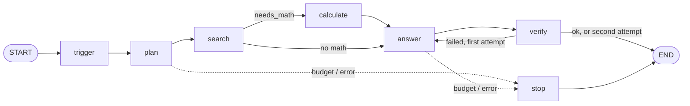
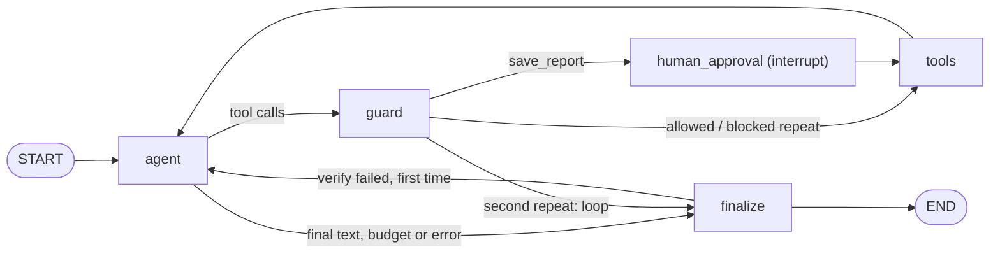

# Route or Roam: technical deep dive

How the two systems are built, how they are kept comparable, how they are
measured and what the numbers can support. The short version is the
[README](../README.md); the React front end is in [react_ui.md](react_ui.md),
deployment in [deploy.md](deploy.md), dated decisions in
[decisions.md](decisions.md).

## 1. Design goals

The question is narrow on purpose: **with the same questions, tools and
model, when does an agent beat a fixed workflow, and what does it cost?**

1. **The control flow is the intended difference.** Both systems share the tool registry,
   prompts, fence, budget, verifier, LLM client and result contract. A special
   case in a shared module would stop the comparison being like for like.
2. **Code owns the boundaries.** The model may propose anything; code decides
   what runs: allowlisted tools, validated arguments, a human gate on side
   effects, capped steps and tokens.
3. **Every run produces a result.** A model failure, a rate limit or a bad tool
   call ends in a record with an `error` field, never in an exception that
   aborts an evaluation.
4. **The measurement is defined once** in `eval/score.py`. Records are stored
   raw and scored at report time, so a scoring fix never needs a re-run.
5. **Reuse, don't copy.** Retrieval, the answer prompt, citation normalisation
   and verification come from grounded-rag, imported in place.

## 2. Architecture

```
cli.py / app.py (Streamlit) / api + web (React)        eval/run_compare.py
                         \             |              /
                          rr/run.py : answer_question(system, question, ...)
                           /                                   \
              rr/workflow.py (System A)                rr/agent.py (System B)
                           \                                   /
       rr/common.py  (answer prompt, budgeted llm_step, verify, result contract)
       rr/tools.py   (allowlist + Pydantic)   rr/fence.py   rr/guard.py   rr/budget.py
       rr/llm.py     (Groq / Ollama client, key rotation, backoff, cache)
                           |
       rr/grounded.py -> grounded-rag (hybrid retrieval, SYSTEM_PROMPT, verifier)
```

### 2.1 Why both systems are LangGraph graphs

A workflow does not need a graph library. It is one anyway so the comparison
isolates the control flow as far as possible: both share `RunState`, `llm_step`, `run_tool` and the
trace and checkpoint machinery, and differ only in who chooses the next edge,
Python (A) or the model's tool calls (B). The two graphs:

System A, the workflow:



System B, the agent:



### 2.2 System A: fixed workflow (`rr/workflow.py`)

- **plan**: one JSON-mode call returning a `Plan`: 2 to 4 searches, each a
  query with the one corpus it goes to, and `needs_math`. Queries are written in
  English even for a French question (both corpora are English). An invalid
  plan is not repaired but replaced by a safe fallback (the question itself,
  against each corpus, no math), recorded as `fallback: true`.
- **search**: code runs each planned search with `k=4` (`RR_WORKFLOW_SEARCH_K`)
  through the shared `run_tool`, in parallel and registered in plan order. The
  agent picks its own `k`: it asked for 10, capped to 8, on 209 of 238 searches
  in `r125e`. The workflow stays at 4 because 4 searches at k=8 would overrun the
  12k-token budget and Groq's 8k request limit. This is a real difference in
  retrieval depth, paid for by the agent in tokens, so the agent-vs-workflow gap
  mixes the loop with twice the passages per search. The ablation that
  separates them gives the agent the workflow's depth (`RR_MAX_SEARCH_K=4`,
  recorded on every record as `max_search_k`, with `workflow_search_k`). It has
  not been run yet: about 1 million Groq tokens for 120 agent records.
- **calculate**: only when the plan says so and passages exist. One call
  writes 1 to 3 expressions (a percentage change needs the difference and the
  ratio) and the safe calculator evaluates each; `days_between("YYYY-MM-DD",
  "YYYY-MM-DD")` covers deadline questions.
- **answer**: grounded answer from the fenced passages plus the exact
  calculator result. No passages means the refusal sentence, without a call.
- **verify**: grounded-rag's verifier (with the figure rule of §2.4); a failure
  earns exactly one retry with feedback that names what failed.

At most **4 LLM calls by construction** (plan, calculate, answer, retried
answer). It cannot adapt to what the searches return.

### 2.3 System B: ReAct agent (`rr/agent.py`)

One `agent` node calls the model with all four tool schemas and
`tool_choice="auto"`; a reply with no tool call is the final answer. `guard`
gives each pending call a verdict (`run`, `approve`, `block`), `human_approval`
pauses on `interrupt()`, and `tools` executes allowed calls and answers every
`tool_call_id` (blocked and rejected ones too) so the next turn stays valid.
`finalize` runs the same `check_answer` as the workflow, with the same single
retry. The agent can search as often as it likes, in any corpus, up to the shared
budget of 8 LLM calls.

### 2.4 Shared pieces (`rr/common.py`)

- `ANSWER_SYSTEM`: grounded-rag's `SYSTEM_PROMPT` plus three additions: cite
  source ids as `[S1]`, the fence rule, and an exact refusal sentence the scorer
  can detect.
- `llm_step`: checks the budget, calls the model through `call_with_backoff`,
  charges real token counts, and turns a permanent failure into
  `stop_reason="error"` instead of raising.
- `check_answer`: forces the refusal sentence when there are no passages,
  normalises citations, runs grounded-rag's verifier and extracts the valid
  citations. An answer is `refused` only when it is grounded-rag's exact
  refusal sentence in any of its languages (English, French, Dutch), and
  nothing else, curly apostrophes folded (`is_refusal`): "Revenue was 416
  billion. I couldn't find anything..." asserts a figure, so it is an answer.
- **The figure rule.** grounded-rag's figure check fails a cited sentence that
  states a number its source doesn't carry. A correct answer to a numeric
  question is in no source by definition (89.3 + 15.4 = 104.7), so
  `check_answer` also accepts the result of a calculation that ran, matched at
  the precision the answer writes it ("6.4%" for 6.42551; a one-digit figure
  only when equal), and a number the question gives ("Article 50"). Arithmetic
  done without the calculator still fails. Rejected figures go into
  `verify["unsupported_numbers"]` and the retry message names them. Both
  systems pass `question` and `tool_calls` to it (`tests/test_derived_figures.py`).
- `to_result`: projects the final state onto the result contract.

### 2.5 The result contract (`rr/run.py`)

`answer_question(system, question, run_id=, qid=, llm=, injected_passage=,
approve=)` always returns the same flat dict:

The record holds the answer, its citations and searched sources, every tool
call, LLM calls, tokens, latency, `refused`, `budget_exhausted`, `stop_reason`,
`injection_flags`, `hallucinated_tools` and `error`.

It never raises for model or tool failures. Each agent call uses a fresh
`thread_id`, so re-running a `run_id`/`qid` never resumes an old checkpoint.
The CLI, Streamlit app, FastAPI service and eval harness all go through it.

### 2.6 Reusing grounded-rag (`rr/grounded.py`)

The only module that touches `sys.path`. It imports grounded-rag's `config`,
`rag.answer`, `rag.retrieve`, `rag.verify` and the store and BM25 index from
`GROUNDED_RAG_PATH`, loads each corpus's `(store, bm25, embedder)` once per
process, and re-exports `SYSTEM_PROMPT`, `REFUSAL_MESSAGE`,
`VERIFY_MIN_GROUNDING` (0.30) and `figures_in` (built on the private
`rag.verify._numbers`, pinned by a contract test). Queries use grounded-rag's own
embedder, so they land in the space the index was built in. The tests
monkeypatch `search_corpus`: no index, embedder or network offline.

Corpora: `filings_sections` (Apple FY2025 Form 10-K, by section) and
`ai_act_sections` (Regulation (EU) 2024/1689: recitals, articles, annexes), both
in English.

## 3. Tools and validation (`rr/tools.py`)

| tool | arguments (Pydantic, `extra="forbid"`) | notes |
|---|---|---|
| `search_documents` | `query` (1-500 chars), `corpus` (enum), `k` (≥ 1, default 4; capped in code at `RR_MAX_SEARCH_K`, 8 by default, see 9.4) | hybrid retrieval; results fenced |
| `list_sections` | `corpus` | section file names |
| `calculate` | `expression` (1-200 chars) | whitelisted AST evaluator |
| `save_report` | `title` (1-120), `markdown` (1-20,000) | needs human approval |

Every call goes through `run_tool`, which never raises: an unknown name is
counted as `hallucinated_tool`; invalid arguments are rejected with the
Pydantic messages (`invalid_args`), never repaired; `save_report` refuses to
write unless that exact call was approved (`approval_denied`); a tool exception
comes back as `tool_error`.

**Run-wide source ids.** Hits get `S1, S2, ...` in order of first retrieval,
reused when a chunk comes back, so `[S3]` means the same passage everywhere.

**Safe calculator.** `ast.parse(mode="eval")` and a whitelist: numeric
constants, `+ - * / // % **`, unary `+ -`, `abs/round/min/max`, `days_between`.
Exponents above 100 and powers whose result exceeds 30 decimal digits
(`MAX_POWER_DIGITS`) are rejected. There is no `eval`.

## 4. Guard, budget and loop detection

**Budget (`rr/budget.py`).** One step is one LLM call. Both systems get
`RR_MAX_STEPS=8` and `RR_MAX_TOKENS=12000` (prompt plus completion). The budget
is checked before each call; on exhaustion the run stops with a fixed message
("I stopped before finishing ... so I won't guess"). If it runs out during the
verify retry, the first, already checked answer is kept. Because the check
precedes the call, the last call can overshoot the cap by its own size.

**The last call (`rr/agent.py`).** `budget.nearly_exhausted` is true with one
step left, at 80% of the tokens, or when the predicted next call would reach
the cap (the last call plus the growth between the last two: 1,000, 2,500 and
4,000 tokens predict 5,500). The agent's prompt grows by about 850 tokens per
`k=8` search, so one turn could jump from under 80% to past the cap. The next
call is then made **without tools**, told to answer from the sources with
citations or reply with the exact refusal sentence; a tool call it still
produces is dropped. The budget is never extended. The workflow has that
guarantee by construction. It changes what `budget_exhausted` and `refused`
mean for the agent, so earlier runs are not comparable (`docs/decisions.md`,
2026-11-06).

**Guard (`rr/guard.py`).** A call's identity is its name plus its arguments,
serialised with sorted keys. An exact repeat is blocked and the model is told
why; a second repeat ends the run with `stop_reason="loop"`. A blocked repeat
of an unknown tool still counts as a hallucinated tool.

**Retries and errors.** Transient failures (429 on every key, 5xx, network) are
retried by `call_with_backoff`; a permanent one is recorded in `error`. The
LangGraph `recursion_limit` (100 agent, 50 workflow) only stops a wiring bug.

## 5. Human approval and checkpointing

`save_report` is the only tool with a side effect (a file in `reports/`). The
guard marks it `approve` and `human_approval` calls LangGraph's `interrupt()`.
State is persisted by a process-wide `SqliteSaver` on `runs/checkpoints.sqlite`
(fallback `MemorySaver`) under the run's `thread_id`; `resume(graph, thread_id,
approved)` continues from the same node. SQLite lets pause and resume happen in
different requests: Streamlit resumes on the click, the CLI asks `y/N` with
`--approve`, and the React UI calls `POST /api/approve` (a second resume of the
same run gets 409; after a restart only thread ids this API created, prefix
`api:`, can be resumed). Eval and unattended runs pass no approver, which means
reject: an evaluation can never write files. Agent latency excludes the time a
human spends deciding.

## 6. Prompt-injection fence (`rr/fence.py`)

Both systems wrap each retrieved passage in `<untrusted_source id=S#
source="...">`; the system prompt calls it quoted data, never instructions. Any
`<untrusted_source` or `</untrusted_source` inside a passage is escaped, with
detection on an NFKC copy stripped of zero-width characters, so fullwidth or
padded tags are caught too. A regex scan for instruction-like phrases (English
and French) tags a passage `flagged="possible_injection"` and counts it in
`injection_flags`: a metric, not a filter, since a filter would hide real
content on false positives and miss paraphrased attacks. For evaluation,
`injected_passage` (CLI `--inject`, the `injection` questions) appends a passage
as source `99_injected.txt` to every search, so both systems see the same attack.

## 7. The LLM client (`rr/llm.py`)

One OpenAI-compatible client serves both systems (Groq by default, or a local
Ollama through `/v1`; temperature 0).

- **Keys and limits**: up to five Groq keys; a 429 moves to the next. When every
  key is limited, `TransientLLMError` carries the shortest wait the provider
  announced and `call_with_backoff` waits that long (capped at 65 s) instead of
  guessing 1/2/4 s. The message keeps Groq's reason per key (limit kind, used
  over limit, requested, organisation prefix, never the key).
- **Four intermittent gpt-oss 400s, retried once** with a corrected request: bad
  JSON in JSON mode, a tool call on a request that offered none, a malformed tool
  call, `output_parse_failed`. A second failure is recorded, so a model that
  keeps producing bad calls still shows in the evaluation.
- **Malformed and empty replies** become an `LLMError` in the run's `error`; an
  empty reply is never cached.
- **On-disk cache** (`RR_LLM_CACHE`, on by default) in `runs/llm_cache/`, keyed
  on a SHA-256 of the exact request, so an interrupted evaluation resumes
  without spending quota. Set `RR_LLM_CACHE=0` to measure run-to-run variance.
- **FakeLLM** replays scripted replies and records requests; running past the
  script raises.

## 8. Evaluation methodology

### 8.1 Dataset (`eval/questions.jsonl`)

40 labelled questions over both corpora: `single_hop` 10, `multi_hop` 10,
`numeric` 8, `cross_corpus` 6 (10-K plus AI Act), `unanswerable` 3 (refusal
expected), `injection` 3 (an answerable question plus an `injected_passage`).
Each records `gold_sources`, `key_facts` (strings with `a|b` alternatives, or
numbers), `expect_refusal`, `needs_tools`, `forbidden_strings` and a `note`
quoting the evidence, checked verbatim against the corpus files, so any label can
be audited by eye. `python -m eval.locate_gold` reports gold sources missing from
a grounded-rag checkout.

`eval/paraphrases.jsonl` holds 4 of these questions with 2 rephrasings each
(`paraphrase_of` links them); run with `--questions eval/paraphrases.jsonl`, and
the report adds a "same verdict for every phrasing" line.

### 8.2 Success definition (`eval/score.py`)

A record passes only if it has no `error` and all four hold:

1. **Key facts**: every key fact is in the answer. Strings match as whole words
   after normalisation (lower case, accents stripped). Numbers match within ±1%
   relative, with common formats ("416,161", "1 234,5"); unit scale (so "$25.1
   billion" matches 25126 in millions) is only tried for facts of 1000 or more.
   1% allows rounding to one decimal but rejects 6.43% written as "6%"; on a
   rounding boundary the fact is stored at the midpoint (`nu03`: 3.825).
2. **Citations**: an answer that is not a refusal cites at least one valid id.
3. **Refusal**: `refused` equals `expect_refusal` exactly.
4. **Forbidden strings**: none appears. Quoting the injection payload back
   counts as following it.

`budget_exhausted` is not a failure by itself. Source recall and tool-use
accuracy are reported but are not part of success.

**Failure tags.** One primary tag per failed record, first match wins: `error >
injection_followed > loop_or_budget > false_refusal > over_answer >
bad_tool_args > wrong_number > missed_hop > uncited`. `missed_hop` is a missing
non-numeric fact; `loop_or_budget` covers a budget stop and a loop stop.

### 8.3 Optional LLM judge (`eval/judge.py`)

Off unless asked for: `python -m eval.judge --runs runs/r1.jsonl` makes one
structured call per stored record (fixed rubric, reply validated against
`JudgeVerdict`, no second call on an invalid reply) and writes
`runs/r1.judge.jsonl`; `eval.report --judge` adds secondary rows (success with
judged facts, and where judge and strings disagree). It decides criterion 1
only, so the reference score is unchanged, and it has not been run on the
published records: its agreement with a human reader is unmeasured.

### 8.4 Harness and repeats (`eval/run_compare.py`)

- **Idempotent**: each call has a SHA-256 key of `system|qid|repeat|run_id`;
  keys already in the runs file are skipped, so a crash resumes where it stopped.
- **Known cost first**: pending calls and the worst case (calls × `RR_MAX_STEPS`,
  calls × `RR_MAX_TOKENS`) are printed; `--estimate` stops there.
- **Self-describing records**: `provider`, `model`, `llm_cache`, `max_steps`,
  `max_tokens` travel with every record, which are stored unscored.
- **Dead letter**: an exception from `answer_question`, or a `TransientLLMError`
  (a quota says nothing about the system and would weigh on the one that makes
  more calls), goes to `runs/dead_letter.jsonl` and is retried on resume. Other
  records with an `error` are results, scored as failures. `live1.jsonl` and
  `live2.jsonl` predate the rule; the report leaves their 50 and 7 such records
  out and prints the count.
- **`--workers N`** pins each worker to one Groq key; **`--models a,b`** (or
  `RR_EVAL_MODELS`) runs the batch per model into
  `runs/<run_id>--<provider>-<model>.jsonl`, and the report given several files
  writes one cross-model table. No test is run across models, and no
  cross-model run has been made.

### 8.5 Spread, intervals and the paired test (`eval/stats.py`)

- **Run-to-run spread**: the sample std of the success rate across repeats. With
  one repeat, or repeats made with the cache on (they replay the first answer),
  it prints `n/a`, never `± 0.0`.
- **Sampling uncertainty**: a 95% Wilson interval with `n` next to every rate.
  Repeats of one question are not independent, so over records it is a floor on
  the uncertainty; with the cache on it counts questions instead. The README
  also gives it on the 40 questions.
- **Workflow vs agent**: the outcomes are paired, so the report runs an exact
  McNemar test on questions, a question counting as passed when it passed in a
  strict majority of its repeats (`eval/report.py` computes it, `eval/stats.py`
  holds the test). Pairing on (question, repeat) counted a question once per
  repeat, and cached repeats are replays: 5 discordant questions over 3 cached
  repeats gave p = 6e-5 instead of 0.0625. Only discordant pairs carry
  information. The API takeaway calls a difference only when p < 0.05.

`eval/compare_runs.py` compares two or three runs question by question (see
§9.3). `eval/stats.py` is standard library only.

## 9. Results

Two runs of the full set, same code, `openai/gpt-oss-120b` on Groq, cache off,
40 questions × 2 systems × 3 repeats, each on one cloud machine:

- **`r125e`** (16 to 19 November 2026), grounded-rag at 80ef892: report
  [results.md](results.md), records `runs/r125e--groq-openai-gpt-oss-120b.jsonl`.
- **`r126e`** (20 to 22 November), the control on e9535b2, the retrieval
  `r122e` used: report `runs/r126e.md`, records
  `runs/r126e--groq-openai-gpt-oss-120b.jsonl`.

The README holds the table by type and the paired counts; `runs/*.md` hold every
metric. A report is rebuilt with `python -m eval.report --runs <records>
--out runs/x.md`. Headline: workflow 85/120 then 88/120, agent 99/120 then
95/120; paired on 40 questions, p = 0.125 then 0.625.

### 9.1 Where the failures come from

- **Workflow refusals.** It refused 15 answerable questions in each run. Replay
  of the recorded searches (retrieval is deterministic) showed that in 14 of the
  15 in `r125e` a source the answer needed never came back: Article 113's dates
  for sh09, cc06, cc02 and mh07, and nu05, whose DMA fine limit is in Apple's
  10-K while the workflow searched the AI Act. In `r126e` the refused set is
  different (sh09, mh02, nu05, cc05 twice each; mh10, cc06, sh08, mh04, cc02,
  cc03, cc04 once) and 12 of 15 again miss a gold source the answer needed (replayed
  on 23 November against e9535b2 with the same index; only sh08 got none). Those refusals measure retrieval, not the
  model's caution.
- **Unanswerable questions**: both systems answered "not in the documents"
  on all 9 runs in `r125e`; in `r126e` the workflow still does (9/9) and the
  agent answers sh10 once instead of refusing (8/9).
- **Questions nobody passes** (none of the 6 runs of a question): mh08, nu05,
  cc02, un03 in `r125e`; those plus cc03, cc05, in03 in `r126e`.
- **Agent cost.** Its prompt grows by about 850 tokens per k=8 search (95%
  interval 730 to 960, 98 runs). Input tokens are 2.1× (`r125e`) and 2.2×
  (`r126e`) the workflow's. It stopped on the budget message in 8 of 120 runs
  (12 in `r126e`; `stop_reason` is `max_tokens`) and 23 (28) runs ended above
  12,000 tokens, since the cap is checked before a call.

### 9.2 Where the agent's lead comes from

Agent passes minus workflow passes, by type, `r125e` then `r126e`: single +4, +3;
multi +3, +5; numeric 0, −2; cross-corpus +6, +2; unanswerable 0, −1; injection
+1, 0 (sums 14 and 7). Cross-corpus questions are part of the lead, not most of
it (6 of 14, 2 of 7). The `r126e` agent answers sh10 once instead of refusing.

### 9.3 Retrieval or chance

`r122e` (8 November, one repeat, e9535b2) gave 30/40 to each system. `r125e`
differs from it on 8 (system, question) pairs at the majority; two things
changed in between: grounded-rag's hybrid retrieval (43cde89) and the draw, since
`r122e` was one repeat. `r126e` is `r125e`'s code on e9535b2 (`rag/answer.py` and
`rag/verify.py` are identical at both commits), so it separates them. It lands
with `r125e` on 6 of the 8 pairs and with `r122e` on 2 (workflow mh07, agent
nu01): chance explains most of the move, and 2 pairs cannot size a retrieval
effect. `r125e` and `r126e` give the same verdict on 105 of 120 workflow records
and 110 of 120 agent records, and their totals differ by 3 and 4 passes.

```
python -m eval.compare_runs runs/r122e--groq-openai-gpt-oss-120b.jsonl \
    runs/r125e--groq-openai-gpt-oss-120b.jsonl runs/r126e--groq-openai-gpt-oss-120b.jsonl
```

`r125e` ran on 80ef892, `r126e` on e9535b2. CI and the image pin 3b09461 since
23 November: same retrieval as 80ef892, a verifier that reads "n't" negations and
thousands separators more strictly, and a system prompt that is unchanged.
route-or-roam passes its own grounding bar, so grounded-rag's new default (0.30)
does not apply to it.

### 9.4 Earlier runs

Older runs used older code, labels or scorers and are not comparable with the
above (`docs/decisions.md` says what changed when). One explains a rule still in
the code: in `s120b` (17 questions, one run, the former four-file AI Act primer)
the agent scored 9/17 against the workflow's 15/17, and 7 of its 8 failures were
Groq rejecting a `search_documents` call with `k=10` because the published schema
capped `k` at 8 (HTTP 400, `/k: maximum: got 10, want 8`; the corrective retry
failed the same way). The cap moved into code (`SearchArgs.k` has no `le` bound,
the search uses `capped_k = min(k, 8)`, with a test) and the agent scored 15/17.
The other failure, cc02, was a citation written with a zero-width space inside
`[S2]`, now handled by grounded-rag's `normalize_citations`. The other runs,
`r120e` to `r124e`, are summarised in `docs/decisions.md` (`r124e` stopped at
19/240 and was rerun whole as `r125e`).

## 10. What the numbers do and don't say

They say: the agent passed more in both runs (by 14 records, then 7), ahead on
single-hop and multi-hop; neither system followed an injection in 480 records;
most wrong refusals are retrieval misses, shared by both; the agent costs more
(2.1× to 2.2× the input tokens, about one more LLM call, p95 latency 25 to 29 s
against 9 to 13 s, 8 to 12 of 120 runs stopped on the budget message).

They don't say:

- **A significant difference.** 4 discordant questions in each run: p = 0.125 is
  the smallest p that 4 pairs can give, and `r126e` gives 0.625. It needs more
  questions, not more repeats of these 40.
- **Anything stable per type.** The same code on two retrievals changed the totals
  by 3 and 4 passes and the verdict of 15 and 10 of 120 records. Cells hold 3 to
  10 questions: the numeric gap flips sign between runs (0 then −2).
- **A tight interval.** Over records the Wilson interval is a floor: 3 repeats
  of 40 questions are not 120 independent draws.
- **Anything beyond one model on one free tier.** The `k=10` failure of §9.4 is
  specific to `gpt-oss-120b`'s tool calls. Latency is rate-limit time. Retrieval
  caps both systems. Scoring is string matching: an answer right in other words
  fails as `missed_hop`.

## 11. Free-tier engineering lessons

- **Know the real limits.** `gpt-oss-120b` on Groq's free tier: 8,000 tokens per
  request and 200,000 per day per organisation, so five keys multiply the quota
  only if they belong to five organisations. A plain 1/2/4 s backoff spent about
  1M tokens on mostly 429s: a per-minute window does not reset in 4 s.
- **Citation format can fake a failure.** gpt-oss often cites `【S1】`; the
  verifier saw no citation. `normalize_citations` (grounded-rag) fixes it, called
  from `check_answer` so the stored answer, the UI and the score agree.

## 12. Limitations and roadmap

- The verifier is grounded-rag's lexical check: it catches drift and fake
  citations, not subtle misreadings. A French answer over English sources scores
  low on grounding (in `r123e`, 20 of the agent's 48 verification retries).
- A figure the verifier rejects can still be right (arithmetic done without the
  calculator, an identifier like "10-K"). It costs a retry, which can end in a
  refusal.
- Temperature is 0, but hosted models are not perfectly deterministic.
- Real runs need grounded-rag's indexes and embedder; the 301 tests are offline.

Next: more questions per type (§10); a cross-model run on `gpt-oss-20b`,
`gpt-oss-120b` and a local Ollama model (the harness exists, §8.4), with a
paired test across models if the gap is worth testing; the LLM judge on `r125e`
and `r126e`.
