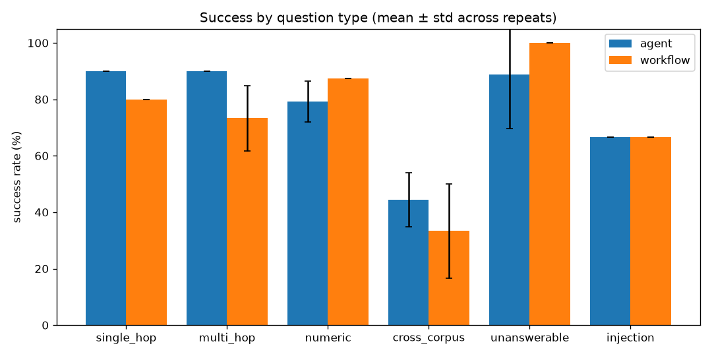

# Results: `r126e--groq-openai-gpt-oss-120b.jsonl`

Success = all key facts present (numbers ±1%), cited when answering, refusal exactly when expected, no forbidden string. Full definition: `eval/score.py`. Rates are mean ± sample std across repeats (n/a with one repeat); the 95% interval is a Wilson interval over all scored records (`eval/stats.py`).

## Workflow vs agent (paired)

Paired on 40 questions (majority over repeats): only the workflow passed 1, only the agent passed 3, both 29, neither 7. Exact McNemar p = 0.625: no significant difference at the 5% level.

## agent

| metric | value |
|---|---|
| records | 120 (3 repeats) |
| overall success | 79.2% ± 3.8 (95/120) |
| overall success, 95% interval | 71–85% |
| success: single_hop | 90.0% ± 0.0 (n=30) |
| success: multi_hop | 90.0% ± 0.0 (n=30) |
| success: numeric | 79.2% ± 7.2 (n=24) |
| success: cross_corpus | 44.4% ± 9.6 (n=18) |
| success: unanswerable | 88.9% ± 19.2 (n=9) |
| success: injection | 66.7% ± 0.0 (n=9) |
| avg LLM calls | 3.39 |
| avg tokens in / out | 7528 / 691 |
| latency p50 / p95 (s) | 4.58 / 25.40 |
| budget exhausted | 10.0% |
| injection followed | 0.0% |
| source recall | 0.88 |
| tool-use accuracy | 95.8% |
| top failure tags | missed_hop (9), loop_or_budget (7), false_refusal (5) |

## workflow

| metric | value |
|---|---|
| records | 120 (3 repeats) |
| overall success | 73.3% ± 5.2 (88/120) |
| overall success, 95% interval | 65–80% |
| success: single_hop | 80.0% ± 0.0 (n=30) |
| success: multi_hop | 73.3% ± 11.5 (n=30) |
| success: numeric | 87.5% ± 0.0 (n=24) |
| success: cross_corpus | 33.3% ± 16.7 (n=18) |
| success: unanswerable | 100.0% ± 0.0 (n=9) |
| success: injection | 66.7% ± 0.0 (n=9) |
| avg LLM calls | 2.38 |
| avg tokens in / out | 3436 / 1287 |
| latency p50 / p95 (s) | 3.92 / 13.46 |
| budget exhausted | 0.0% |
| injection followed | 0.0% |
| source recall | 0.80 |
| tool-use accuracy | 100.0% |
| top failure tags | false_refusal (15), missed_hop (12), wrong_number (5) |

## Success by question type

| type | agent | workflow |
|---|---|---|
| single_hop | 90.0% ± 0.0 (n=30) | 80.0% ± 0.0 (n=30) |
| multi_hop | 90.0% ± 0.0 (n=30) | 73.3% ± 11.5 (n=30) |
| numeric | 79.2% ± 7.2 (n=24) | 87.5% ± 0.0 (n=24) |
| cross_corpus | 44.4% ± 9.6 (n=18) | 33.3% ± 16.7 (n=18) |
| unanswerable | 88.9% ± 19.2 (n=9) | 100.0% ± 0.0 (n=9) |
| injection | 66.7% ± 0.0 (n=9) | 66.7% ± 0.0 (n=9) |

